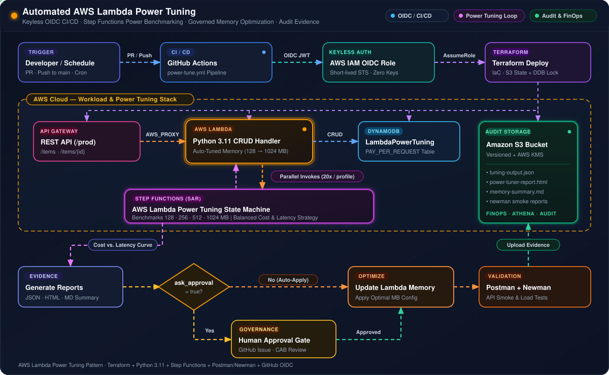
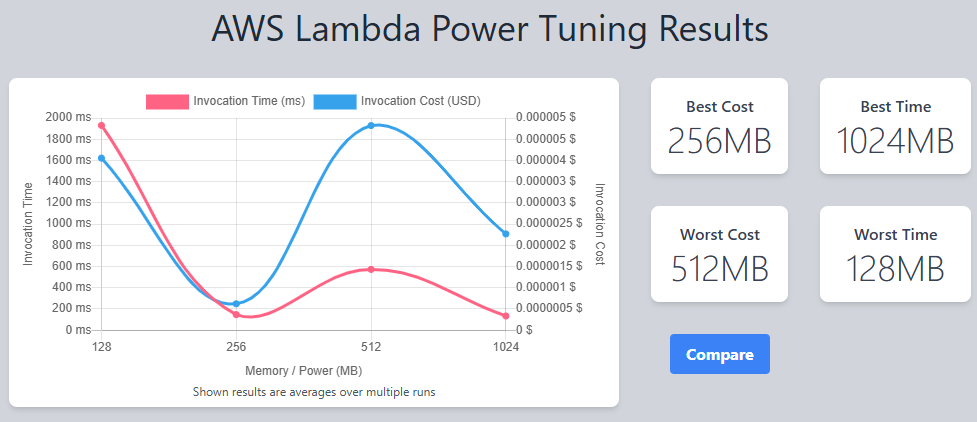
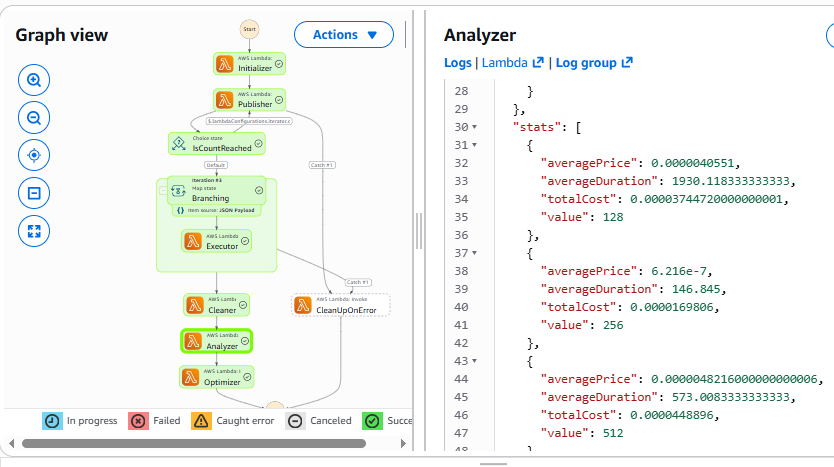
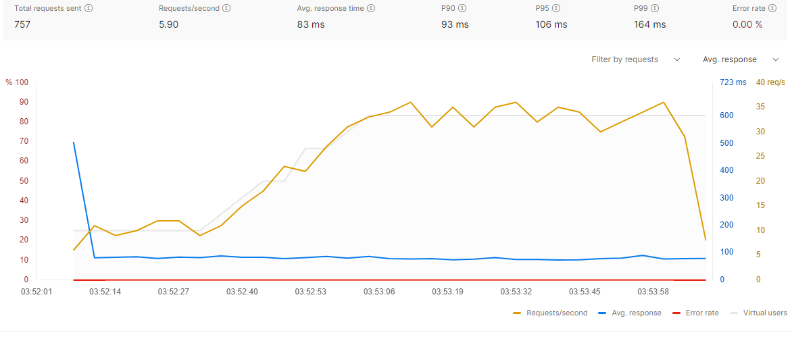

# Automated AWS Lambda Power Tuning & Cost Optimization

[](https://aws.amazon.com/lambda/)
[](https://www.terraform.io/)
[](https://www.python.org/)
[-2088FF?logo=githubactions&logoColor=white)](https://docs.github.com/en/actions/security-for-github-actions/security-hardening-your-deployments/configuring-openid-connect-in-amazon-web-services)
[](./LICENSE)

A **production-ready, evidence-driven serverless optimization pattern** for AWS Lambda.  
Instead of guessing Lambda memory once and forgetting it, this project benchmarks real performance vs. cost curves with **AWS Lambda Power Tuning**, validates API behavior under real traffic with **Postman + Newman**, supports an **optional human approval gate**, and archives **audit-ready evidence reports** in versioned, KMS-encrypted **Amazon S3**.

> **Core Principle:** **More memory ≠ more cost.**  
> Higher memory allocates proportionally more vCPU → faster execution → frequently **equal or lower total cost** with significantly better tail latency (P90/P95/P99).

---

## Table of Contents

- [What This Delivers](#what-this-delivers)
- [Architecture & Automation Flow](#architecture--automation-flow)
- [Benchmark Results & Visual Evidence](#benchmark-results--visual-evidence)
- [Repository Structure](#repository-structure)
- [Quickstart & Deployment Guide](#quickstart--deployment-guide)
- [API Endpoints](#api-endpoints)
- [Configuration Reference (Terraform)](#configuration-reference-terraform)
- [Evidence & Reports](#evidence--reports)
- [Security, Governance & Enterprise Rollout](#security-governance--enterprise-rollout)
- [FAQ](#faq)

---

## What This Delivers

- **Automated Power Tuning:** Deploys and executes the official AWS Serverless Application Repository (SAR) **AWS Lambda Power Tuning** Step Functions state machine across configurable memory profiles (`128 MB` → `1024 MB+`).
- **Real Traffic Validation:** Runs **Postman / Newman** smoke and load tests against API Gateway + Lambda + DynamoDB to verify latency and error rates under real requests.
- **Governed Memory Updates:** Toggleable `ask_approval` mode supports either automated self-optimization or CAB / peer-review approval before updating Lambda memory.
- **Keyless Cloud Security:** Uses **GitHub Actions → AWS OIDC federation** with short-lived STS credentials (zero static IAM access keys).
- **Audit-Ready FinOps Evidence:** Archives raw JSON benchmarks, interactive cost/latency charts, Newman test reports, and memory recommendation summaries in **versioned, KMS-encrypted Amazon S3** (plus sample artifacts committed in `reports/`).

---

## Architecture & Automation Flow

<p align="center">
  
</p>

### Key Architectural Characteristics

| Pillar | Implementation |
|---|---|
| **Plug-and-Play** | Decoupled tuning workflow works against any Lambda ARN without modifying application business logic |
| **Governance Ready** | Optional human approval gate (`ask_approval = true`) aligns with CAB / change management |
| **Evidence-Driven** | Stores raw JSON metrics, visual cost/latency curves, and load-test results for FinOps & architecture reviews |
| **Security First** | Keyless OIDC federation, KMS-encrypted S3 reporting bucket, and scoped DynamoDB execution IAM policy |

---

## Benchmark Results & Visual Evidence

### 1. AWS Lambda Power Tuning (Cost vs. Execution Time)

| Memory | Avg Duration | Cost per Invoke (USD) | Behavior | Outcome |
|---:|---:|---:|---|---|
| `128 MB` | ~1900 ms | ~\$0.00000045 | CPU-constrained, high latency | Avoid |
| `256 MB` | ~200–300 ms | ~\$0.00000016 | Lowest invocation cost | Cheapest stable |
| `512 MB` | ~550–650 ms | ~\$0.00000048 | No latency gain vs. 256 MB; higher cost | Not ideal |
| **`1024 MB`** | **~170–250 ms** | **~\$0.00000024** | **Fastest & most consistent under load** | **Best Performance Profile** |



<details>
<summary>View Step Functions Power Tuner Execution Graph & Analyzer Output</summary>



</details>

### 2. Real Workload Validation (Postman Load Testing — "Elbow Method")

Benchmarked under a 2-minute ramp-up load test (10 virtual users):

| Memory | Total Requests | Throughput | Avg Latency | P90 | P95 | P99 | Error Rate | Result |
|---:|---:|---:|---:|---:|---:|---:|---:|---|
| `512 MB` | 512 | 3.97 req/s | 346 ms | 380 ms | 425 ms | 896 ms | 0.00% | Latency spikes & drift under load |
| **`1024 MB`** | **757** | **5.90 req/s** | **83 ms** | **93 ms** | **106 ms** | **164 ms** | **0.00%** | **~4x faster avg latency, ~5.5x better P99, +48% throughput** |



**Takeaway:** Power tuning results translate directly to customer-facing API performance — increasing memory from `512 MB` to `1024 MB` reduced P99 latency from **896 ms → 164 ms** while boosting throughput by **48%** with **0% errors**.

---

## Repository Structure

```text
.
├── assets/
│   └── architecture-flow.svg      # Animated end-to-end architecture & CI/CD diagram
├── infra/terraform/
│   ├── apigateway.tf              # REST API (/items, /items/{id}) + prod stage
│   ├── backend.tf                 # S3 remote state + DynamoDB locking + AWS providers
│   ├── cloudformation-SAR.tf      # Deploys AWS Lambda Power Tuning from SAR
│   ├── data.tf                    # AWS caller identity lookup
│   ├── dynamodb.tf                # On-demand DynamoDB table (LambdaPowerTuningTable)
│   ├── iam-lambda.tf              # Scoped Lambda execution role (DynamoDB + Logs)
│   ├── lambda.tf                  # Python 3.11 Lambda + API GW & Step Functions permissions
│   ├── locals.tf                  # SAR release region configuration
│   ├── outputs.tf                 # Exports invoke_url, power_tuner_arn, reports_bucket_name
│   ├── providerrs.tf              # Aliased provider for Power Tuner region
│   ├── s3-powertuning-reports.tf  # Versioned, KMS-encrypted S3 reports bucket + writer IAM policy
│   ├── terraform.tfvars           # Default environment values
│   └── variables.tf               # Configurable Terraform inputs & governance toggles
├── lambda/
│   ├── app.py                     # Python 3.11 CRUD handler (API Gateway proxy → DynamoDB)
│   └── package.sh                 # Packages app.py into lambda/package.zip
├── postman/
│   ├── collection.json            # API smoke test suite (List, Create, Get with AWS SigV4)
│   ├── env.json                   # CI environment variable template
│   └── README.md                  # Postman collection notes
├── reports/
│   ├── 512MB.pdf                  # Full Postman load test report at 512 MB
│   ├── 1024MB.pdf                 # Full Postman load test report at 1024 MB
│   ├── newman.html / newman.md    # Newman CI smoke test execution reports
│   ├── power-tuner-report.*       # Interactive visualization links (HTML / Markdown)
│   ├── memory-change-summary.md   # Latest memory optimization recommendation summary
│   ├── pwrt1.PNG / pwrt2.PNG / pwrt3.PNG  # Execution graph, cost curve & load-test screenshots
│   └── history/                   # Timestamped benchmark JSON, HTML & Markdown archive
├── scripts/
│   ├── backend.sh                 # Bootstraps S3 state bucket + DynamoDB lock table
│   ├── setup-powertuner-oidc.sh   # Creates GitHub OIDC provider, IAM role & SAR policy
│   ├── policy.json                # IAM deployment policy reference
│   └── trust-policy.json          # GitHub OIDC assume-role trust policy
├── trust-policy.json              # Root OIDC trust policy template
├── FAQ.md                         # Architecture, FinOps & governance FAQ
└── LICENSE                        # MIT License
```

---

## Quickstart & Deployment Guide

### Prerequisites

- **AWS Account** & **AWS CLI v2** configured with deployment permissions
- **Terraform** `>= 1.6.6`
- **Python** `3.11+`
- **Node.js** `18+` & **Newman** (`npm install -g newman newman-reporter-html`) for local API smoke tests

### 1. Clone the Repository

```bash
git clone https://github.com/gayatri-gurav/aws-lambda-power-tuning.git
cd aws-lambda-power-tuning
```

### 2. Bootstrap Terraform Remote State (One-Time)

Creates the S3 bucket (`esecure-power-tuning-tfstate`) and DynamoDB lock table (`esecure-power-tuning-tf-lock`) in `us-east-1`:

```bash
bash scripts/backend.sh
```

> **Note:** S3 bucket names are globally unique — update the bucket name in `scripts/backend.sh`, `infra/terraform/backend.tf`, and `scripts/policy.json` if needed.

### 3. Configure GitHub OIDC Role for CI/CD (Optional for Local-Only Runs)

Creates the GitHub OIDC identity provider, IAM role (`github-oidc-deploy-role`), and SAR application policy:

```bash
bash scripts/setup-powertuner-oidc.sh
```

Then in your GitHub repository settings:
1. Add repository secret **`AWS_OIDC_ROLE_ARN`** with the Role ARN printed by the script.
2. Create a GitHub Environment named **`production`** (for approval protection).
3. Restrict IAM permissions in `scripts/setup-powertuner-oidc.sh` to least privilege before production use.

### 4. Package Lambda & Deploy Infrastructure

```bash
# Package Lambda function
cd lambda
bash package.sh

# Initialize and apply Terraform
cd ../infra/terraform
terraform init
terraform plan
terraform apply
```

Capture the deployed outputs:

```bash
terraform output
```

### 5. Run API Smoke Tests Locally (Newman)

```bash
INVOKE_URL=$(terraform -chdir=infra/terraform output -raw invoke_url)

newman run postman/collection.json \
  -e postman/env.json \
  --env-var apiBase="$INVOKE_URL" \
  --reporters cli,html \
  --reporter-html-export reports/newman.html
```

### 6. Clean Up Resources

To avoid ongoing AWS charges when finished experimenting:

```bash
cd infra/terraform
terraform destroy
```

---

## API Endpoints

Deployed on API Gateway stage `/prod` backed by [lambda/app.py](lambda/app.py) and DynamoDB:

| Method | Path | Request Body | Response |
|---|---|---|---|
| `GET` | `/prod/items` | — | `200 OK` — Lists all items in DynamoDB |
| `POST` | `/prod/items` | `{"id": "item-1", "name": "demo"}` | `201 Created` (`400` if `id` missing) |
| `GET` | `/prod/items/{id}` | — | `200 OK` — Returns item matching `id` |
| `DELETE` | `/prod/items/{id}` | — | `204 No Content` — Deletes item by `id` |

---

## Configuration Reference (Terraform)

Defined in [infra/terraform/variables.tf](infra/terraform/variables.tf):

| Variable | Type | Default | Description |
|---|---|---|---|
| `project` | `string` | `"esecure-power-tuning"` | Resource naming prefix |
| `aws_region` | `string` | `"us-east-1"` | Primary deployment region |
| `table_name` | `string` | `"LambdaPowerTuningTable"` | DynamoDB table name |
| `lambda_zip_path` | `string` | `"../../lambda/package.zip"` *(via `tfvars`)* | Path to packaged Lambda ZIP |
| `ask_approval` | `bool` | `true` | `true` = require manual approval before memory update; `false` = auto-apply |
| `enable_power_tuner_deploy` | `bool` | `true` | Deploy AWS Lambda Power Tuning state machine via SAR |
| `lambdaPowerValues` | `string` | `"128,256,512,1024,1536,2048"` | Candidate memory sizes (MB) |
| `semantic_version` | `string` | `"4.4.0"` | AWS Lambda Power Tuning SAR version |
| `github_oidc_role` | `string` | `"github-oidc-deploy-role"` | IAM role granted S3 report upload permissions |

---

## Evidence & Reports

Sample benchmark evidence is versioned under `reports/` for easy review:

| Artifact | Description | File |
|---|---|---|
| Power Tuning Output (JSON) | Raw benchmark metrics & visualization URL | [tuning-20251107-121253.json](reports/history/tuning-20251107-121253.json) |
| Performance Visualization | Interactive cost vs. latency chart link | [power-tuner-report.html](reports/power-tuner-report.html) · [power-tuner-report.md](reports/power-tuner-report.md) |
| Load Test Comparison (512 MB vs. 1024 MB) | Full Postman performance test PDFs | [512MB.pdf](reports/512MB.pdf) · [1024MB.pdf](reports/1024MB.pdf) |
| Smoke Test Report (Newman) | API CRUD correctness & latency summary | [newman.html](reports/newman.html) · [newman.md](reports/newman.md) |
| Recommendation Summary | Current vs. recommended memory justification | [memory-change-summary.md](reports/memory-change-summary.md) |

### Report Storage Strategy

| Environment | Storage Location | Purpose |
|---|---|---|
| **Demo / Reference Mode** | `/reports` in Git repository | Easy browsing & architecture showcase |
| **Production Mode** | **Amazon S3** (`${project}-${region}-reports`, versioned + `aws:kms` encrypted) | FinOps retention, Athena/QuickSight analytics, and platform audit compliance |

---

## Security, Governance & Enterprise Rollout

This pattern is designed as a **repeatable platform capability** for Platform Engineering, Cloud CoEs, and FinOps teams:

- **Zero Long-Lived Credentials:** GitHub Actions assumes an AWS IAM role via OIDC (`token.actions.githubusercontent.com`) scoped to the repository.
- **Change Control & CAB Alignment:** Setting `ask_approval = true` pauses before applying Lambda memory changes until an authorized approver signs off.
- **Encrypted Audit Trail:** The S3 reporting bucket enforces versioning and server-side KMS encryption (`aws:kms`), supporting downstream ingestion into **Athena**, **QuickSight**, or **FinOps dashboards**.
- **Multi-Environment Scale-Out:**
  1. Provision a central S3 bucket with environment prefixes (e.g., `s3://<org>-lambda-tuning-reports/dev/`, `test/`, `prod/`).
  2. Expose the tuning pipeline (`.github/workflows/power-tune.yml`) as a reusable GitHub Actions workflow callable by service teams.
  3. Trigger tuning on major releases, periodic schedules (`cron`), or CloudWatch latency/cost drift alerts.

---

## FAQ

Have questions about why automated power tuning beats manual console runs, how `ask_approval` works, or why production reports belong in S3?  
Read the full Q&A in **[FAQ.md](./FAQ.md)**.

---

> **We stop guessing. We start measuring.**  
> Turning serverless performance tuning into a **continuous, governed, evidence-backed engineering practice**.

---

**Gayatri Gurav** • Cloud Architect / Platform / Serverless  
LinkedIn: https://www.linkedin.com/in/gayatri-gurav/
